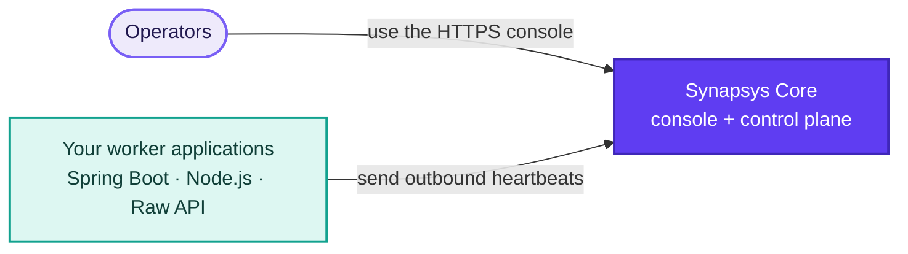
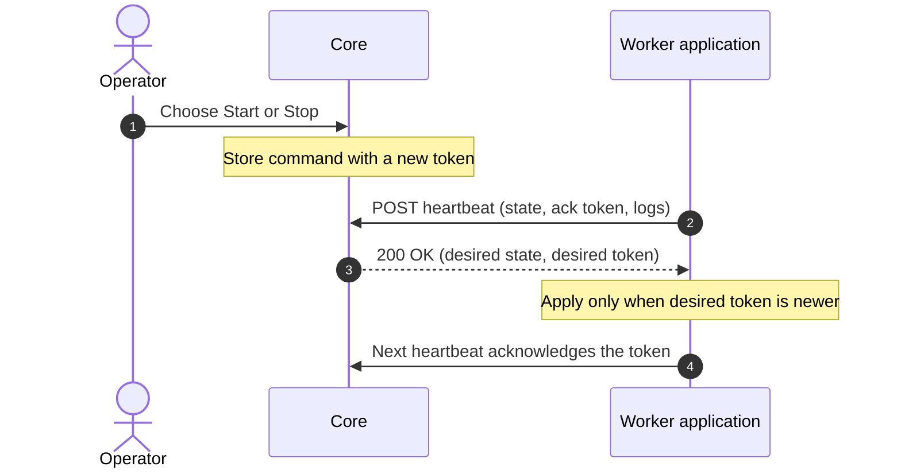

# System model

Synapsys has one Core and any number of workers. Operators use Core; applications
connect to it as workers. Every network connection from a worker is outbound.

The command travels back in the HTTP response to the heartbeat. It is not a second
connection, callback, or inbound request to the worker.

## A command round trip

The worker opens both heartbeat connections. Core only answers them.

## Core

Core serves the responsive operator console and control API. It records the latest
worker state, process state, execution history, actions, worker-token metadata, and
captured output.

## Worker

A worker is one application connected through a starter, SDK, or the Raw API. Its
name is its identity across restarts. The same worker sends every registered process
on each heartbeat.

## Process

A process is a named unit of work inside a worker. Names are unique within a worker,
so two applications may both expose `nightly-sync` without colliding. A process is
either endless or progressive and reports `idle`, `running`, `stopping`, or `failed`.

## Execution and action

An execution is one run of a process. Its output is viewed independently from other
runs. An action records a control event such as a start, stop, heartbeat, or command
acknowledgement, providing an operational history of how state changed.

## Connectivity consequence

Workers need outbound HTTPS access to Core but no inbound listener. With a five-
second heartbeat interval, a command is normally observed within up to five seconds.
Choose an interval that balances response time and request volume for your fleet.
