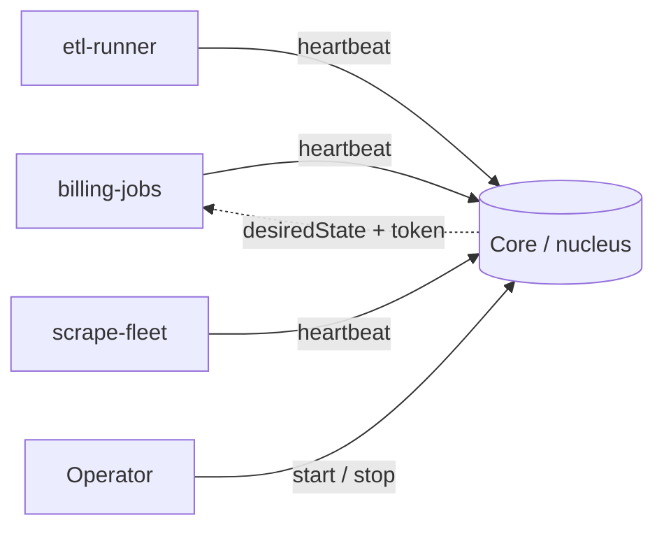

# Architecture

Synapsys has one central node and any number of workers. Everything flows in one
direction: workers call the Core, never the reverse.



The dashed arrow is not a second connection. It is the response body of the
heartbeat the worker itself opened.

## The four entities

**Core** — the central node. Holds every worker, process and execution record,
serves the console, and is the only component with a database.

**Worker** (*neuron*) — one of your applications. Identified by `workerName`,
which must be stable across restarts; that is how the Core recognises a returning
worker rather than inventing a new one.

**Process** — a unit of work inside a worker. Names are unique **per worker**, not
globally, so two workers may both have a `nightly-sync`. Because of that,
processes are addressed by id, not by name:

```
PUT /api/processes/{id}/desired-state
```

**Execution** — one run of a process. Carries a `runId` while it is in flight.

## Why workers never listen

A worker opens no port, which means:

- no inbound firewall rule, no ingress, no reverse proxy
- workers can live behind NAT, on a laptop, in a locked-down VPC
- the Core needs no credentials for, or network route to, anything it manages

The cost is latency. A command is picked up on the next heartbeat, so with the
default 5-second interval a start takes up to 5 seconds to be seen. For starting
and stopping background jobs that is a trade worth making.

## Two kinds of process

**Endless** — runs until stopped. Gets its own daemon thread and cooperates with a
stop signal.

**Progressive** — runs to completion. Gets a dedicated single-thread executor and
is cancelled by interrupting it; it must check for cancellation at safe points.

The distinction is not cosmetic: it decides how the process is scheduled, how it
is stopped, and whether reaching `idle` means "finished" or "was stopped".
