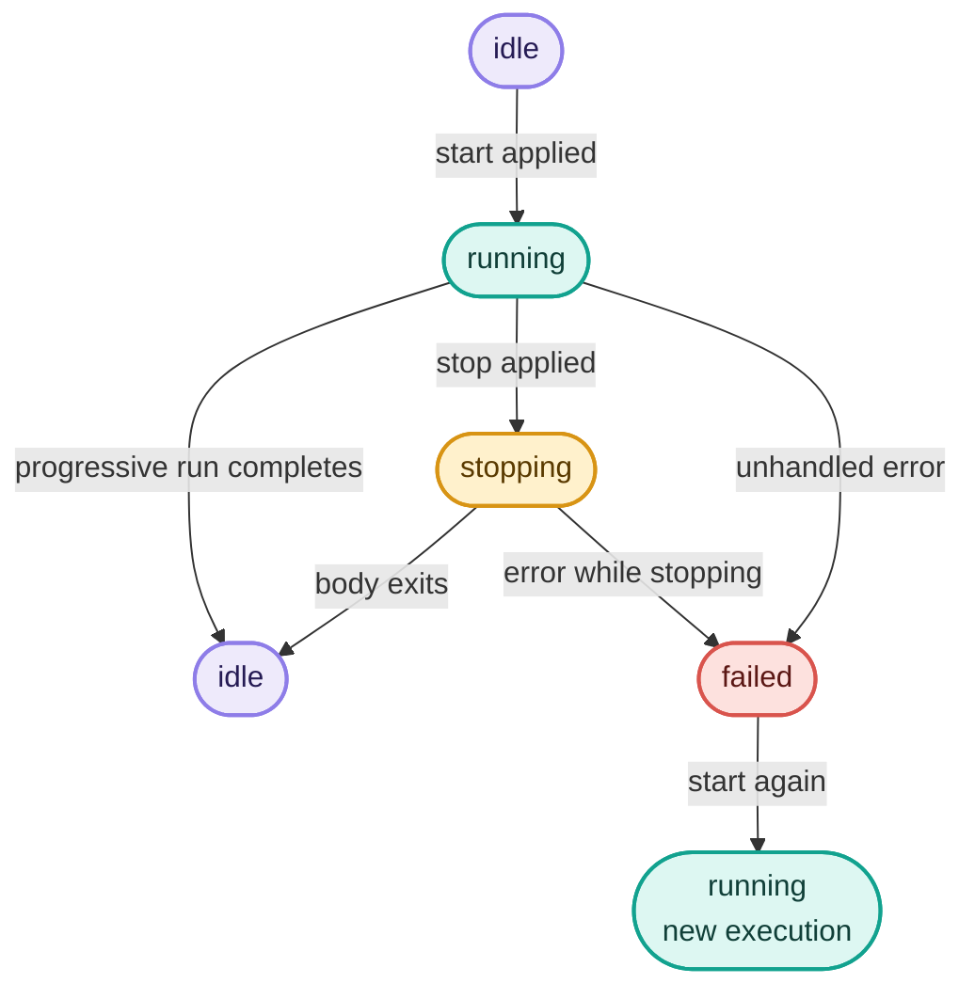

# Execution states

A process is always in exactly one of four states. Three of them can also be
*requested*; one can only ever be *observed*.

| State | Meaning | Can the Core ask for it? |
|---|---|---|
| `idle` | Not running. As a desired state it means **no command**, not "stop". | Yes |
| `running` | Executing now. | Yes |
| `stopping` | A stop was requested and the process has not finished yet. | Yes |
| `failed` | Terminated abnormally. | **No** |

## Why `failed` is not commandable

`failed` is a fact about what happened, not an instruction. Nothing can be
*told* to fail, so the Core rejects it as a desired state.

The distinction is enforced in two separate checks rather than one: a state is
valid as something a worker **reports**, or valid as something the Core may
**command**, and `failed` passes only the first. A client that accepts `failed`
as a command is wrong even if the Core never sends it.

## `idle` is not "stop"

This is the single most common mistake when writing a client.

After a command completes, the Core resets `desiredState` back to `idle` to mean
"there is nothing outstanding for you". A worker that reads that as an
instruction will stop every process it owns on the very next beat.

Stop is `stopping`. Nothing else is.

## The lifecycle

A progressive process also reaches `idle` on its own, by finishing — no stop
command is involved. A failed process can be started again, which creates a new
execution. The repeated `idle` and `running` nodes keep the reading direction clear;
they represent the same states.

:::note[Desired state is not current state]

The arrows describe what the worker actually reports. After a command is
acknowledged, Core may show desired state `idle` to mean “nothing is pending” while
the current state remains `running`.

:::

## Reporting a state you cannot determine

Do not guess. If a client cannot tell what a process is doing, it should omit
that process from the batch rather than reporting a plausible state. The Core
keeps the rest of the batch and treats the absent process as unchanged; a wrong
`currentState` makes the Core clear a command that was never applied.
